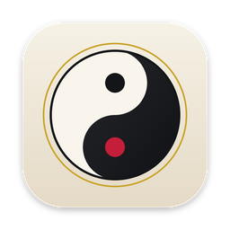
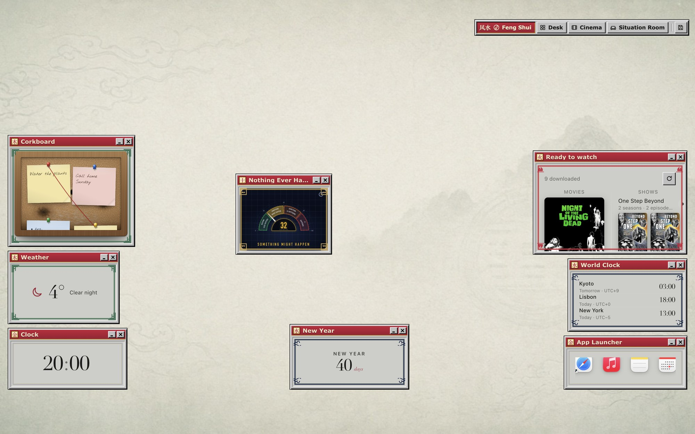
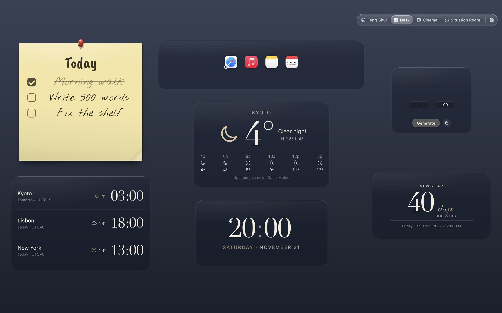
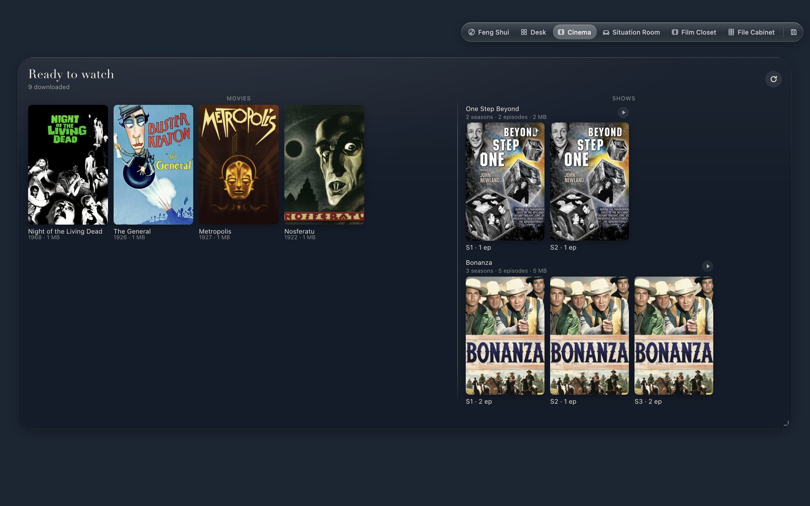
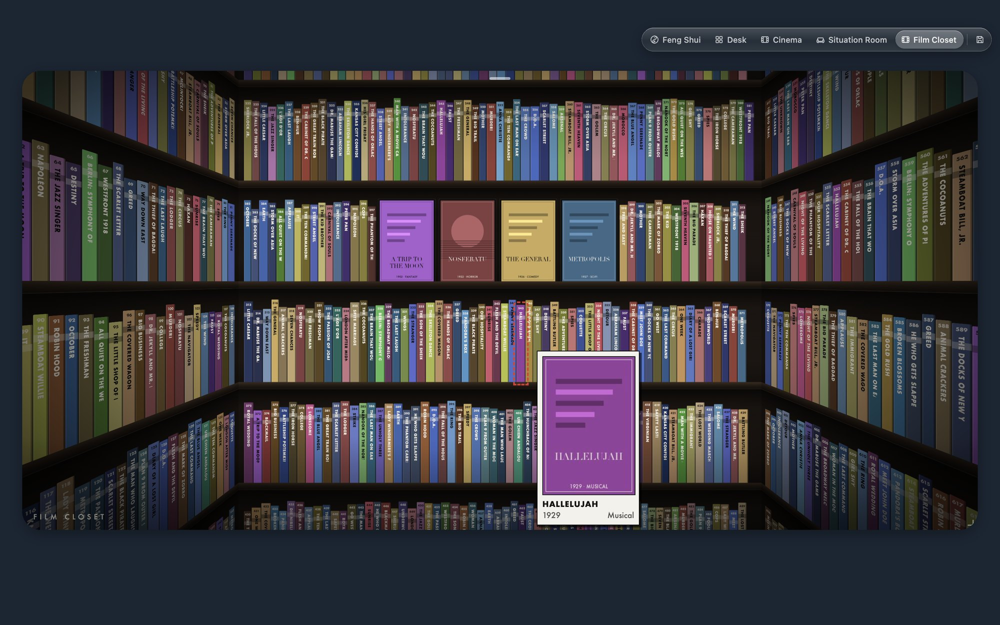
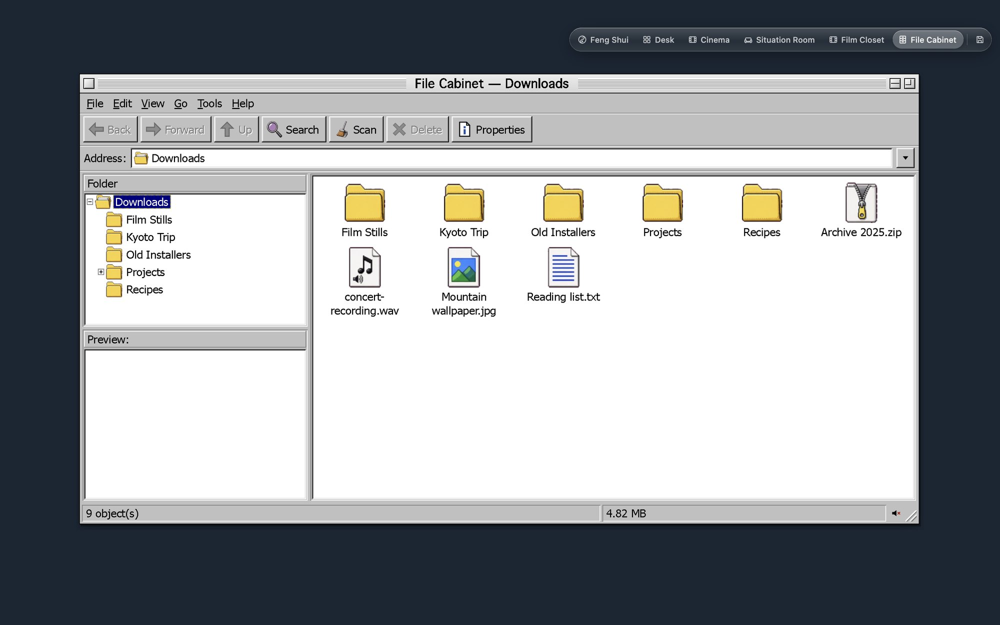
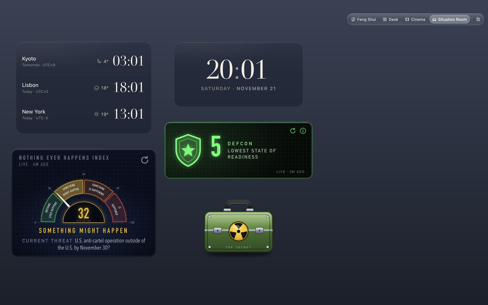
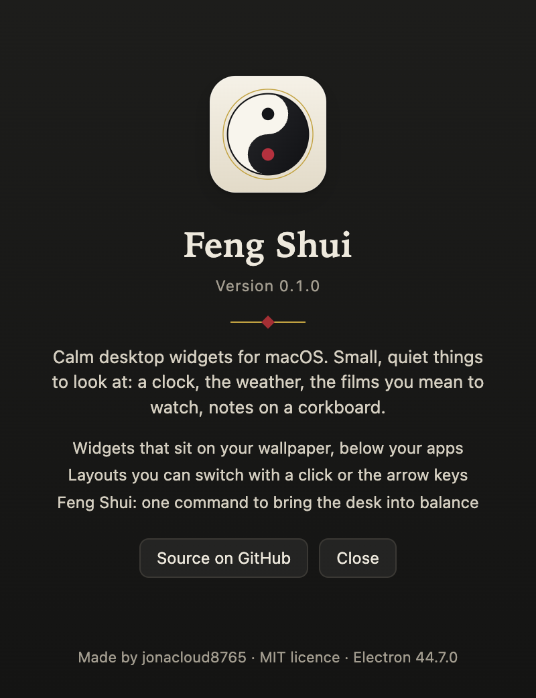

<p align="center">
  
</p>

<h1 align="center">Feng Shui</h1>

<p align="center">Calm desktop widgets for macOS.<br>
Clocks, weather, films, notes, a corkboard and a few small toys, each a window of its own, arranged so the desktop feels balanced.</p>

<p align="center"></p>

Free and open source under the MIT licence.

| | |
| --- | --- |
|  |  |
| **Desk.** Glass widgets with real macOS blur. | **Cinema.** Films, with each show's seasons gathered together. |
|  |  |
| **Film Closet.** A walk-in shelf of films; hover a spine for its poster. | **File Cabinet.** A 90s file explorer for your Downloads. |
|  |  |
| **Situation Room.** Corkboard, whiteboard and gauges. | **About.** |

Screenshots are taken from the running app with demo data.

## Install

Requires macOS and Node.js. No Xcode needed: the Command Line Tools that come
with macOS are enough to build the small native helper.

```sh
git clone https://github.com/jonacloud8765/feng-shui.git
cd feng-shui
npm install      # first time only; also builds the native helper
npm start
```

To build a double-clickable app:

```sh
npm run package  # creates "dist/Feng Shui.app" (signed ad hoc for this Mac)
```

Drag it into Applications. "Open at login" only works from the packaged app.

Feng Shui lives in the menu bar (the sun on the horizon icon). From there you
can show or hide all widgets (⌥⌘W), add widgets, switch layouts, keep the Mac
awake and open settings.

## What's new

- **SQUEEZE, the clean file studio.** A new layout for shrinking files and
  removing personal metadata (location, camera, author, dates, software) from
  photos, PDFs, video and audio, all on this Mac. Drop files or folders in,
  pick Quick Squeeze (lossless, the default), Pure Clean (metadata only) or
  Maximum Squeeze (smaller, with any quality loss shown and approved first).
  Each result is checked against its original first; then the original goes
  to the Trash and the squeezed file takes its name and place (a setting
  keeps both instead, as `name (squeezed).ext`). Nothing is ever made bigger.
  Maximum Squeeze has smart photo compression: big photos can be resized to
  2,560 px, and quality steps down from 85 until a perceptual check (DSSIM)
  says the next step would show; photos that will not shrink 5% are marked
  “Already optimized”.
  HEIC photos are converted to high-quality JPGs (a setting turns this off).

- **A living yin yang.** The Feng Shui layout now has a flat, generative yin
  yang at its centre on warm paper: two halves that keep changing shape and
  trade places, orbits, particles and rose curves that draw themselves and
  fade. The Five Elements sit around it as small animated systems on the
  generating ring marked with alchemical symbols (Fire, Earth and Water
  triangles, Venus for Metal, Jupiter for Wood), with the controlling star
  inside and live readings. Fire is a flickering flame, Water a falling drop
  with ripples over layered currents, Earth a sun crossing layered hills with
  a balancing cairn, and Metal meshing gears driving a conveyor and stamping
  press. Widgets take a light, warm glass with charcoal type, and the bagua
  arrangement keeps the centre open; the yin yang finds the free space and
  sizes itself to it.
- **The Feng Shui look.** A layout named "Feng Shui" puts every widget on one
  shared liquid glass, with the same tint, radius and light, over ink
  mountains in mist at dusk. Each widget carries one quiet note of its element
  (木 火 土 金 水): a breath of colour in a corner and a small seal on hover. The
  bagua arrangement sets them in three mirrored columns with even spacing.
  Other layouts are untouched.
- **Shows grouped in Films.** Episodes and seasons of the same show sit
  together in order, even when they came from different folders, each season
  the same size as a movie poster, with a Play All button.
- **Arrow keys for layouts.** Choose Switch with ← → Keys in the layout menu,
  or click the layout bar, then use ← and → to move between layouts. Esc or
  Return finishes.
- **Save and lock.** The button at the end of the layout bar keeps the layout
  exactly as it is and locks every widget in place. Click it again to unlock.
  Save Layout As New… in the menu bar still makes a copy.
- **Keep Mac Awake.** A menu-bar toggle under Show Layout Bar, with session
  details, an End Current Session button, and sessions that last indefinitely,
  for some minutes or hours, until a time, while an app is running or while a
  file is downloading. It can allow the display to sleep. ⌥⌘A toggles it.
- **About window.** Version, the features at a glance and a link to the source.

## Using widgets

- **Move:** drag a widget by its background. It snaps to screen edges and lines
  up with other widgets. You can turn snapping off in General.
- **Resize:** drag any edge, or the corner grip that appears on hover.
- **Customize:** double-click a widget, or right-click and choose Customize….
- **Right-click** a widget to duplicate, hide or remove it, plus actions for
  that widget (flip, generate, lap, refresh).
- **Gallery:** add as many of each widget as you like.
- **Layouts:** each layout keeps its own widgets, positions, sizes and styles.

Widgets: Clock, Countdown, Random Number, Stopwatch, App Launcher,
Weather, World Clock, Sticky Note, Photo, Films, Films Watched, Custom Widget, Corkboard, NF Widget,
Whiteboard, DEFCON, Nothing Ever Happens, Record Room and Library.

## Where things are saved

`~/Library/Application Support/Feng Shui/fengshui-config.json`. Changes are written
within a moment. If the file is damaged, Feng Shui keeps the damaged copy next to
it (`fengshui-config.corrupt-<time>.json`), starts fresh and tells you.

## Films

The Films widget shows the videos in a folder (your Movies folder unless you
choose another) under **Already downloaded**, then the rest of a public
Letterboxd watchlist. Episodes are grouped by show, then by season in order.

- **Play:** click a downloaded film to open it in [VLC](https://www.videolan.org/vlc/).
  A season opens as a playlist. If VLC isn't installed, the widget says so.
- **Downloads:** Movies, then Shows. Each show has a header with a Play All
  button and its seasons in order, at the same size as the movie posters.
- **Sections:** show downloads, the watchlist, or both, with an optional heading,
  so one widget can be a "Ready to watch" panel and another a watchlist shelf.
- **Watchlist:** enter your Letterboxd username in the widget's settings. The
  watchlist is read from your public watchlist page, kept for 12 hours, and
  refreshed with the refresh button. If Letterboxd can't be reached, the last
  copy stays on screen with the reason. Click a watchlist film to open its
  Letterboxd page, or the "On your watchlist" heading to open the whole
  watchlist in Chrome (or your default browser).
- **Finding films:** filter the watchlist by decade and genre, sort it (when
  added, name, popularity, shuffle, release date, average rating, length) or
  search by title, actor or director in the same box. The total running time of the films shown appears
  under the filters. Genres, ratings and lengths come from each film's public
  Letterboxd page, read slowly in the background once and then kept.
- **Artwork:** a poster or thumbnail image next to a video (`<name>.jpg`,
  `poster.jpg`, `folder.jpg`, `cover.jpg`) is used first. Otherwise the poster
  comes from Letterboxd, or for shows from [TVmaze](https://www.tvmaze.com/)
  (the season's poster when there is one). Posters are saved in the app's data folder under `films/`.
- **Settings:** watch folder, username, layout (poster grid, shelves or list),
  poster size, whether to show the rest of the watchlist, and a size limit that
  skips small clips.

## Films Watched

How many films a Letterboxd member has logged as watched, read from their
public Films page and checked hourly, printed on a cinema ticket stub. Click
the ticket to flip through its three looks: Admit One, Picture House and
Midnight Premiere. Set a goal to add a progress bar.

## Sticky Note

A note with an optional title and a body, each with its own font. Select text
and press ⌘U, ⌘B or ⌘I, or use the small bar that appears over a selection, to
underline, bold or italicize it.
Start a line with "- " for a bulleted list or "[] " for a checklist (or press
⌘⇧7 / ⌘⇧L), and click a box to tick it. Pin the note with washi tape, a
pushpin (six colors), or nothing. Paper notes are drawn as real paper with a
lifted-corner shadow; the Glass paper keeps the glass look. Double-clicking a
note selects text; use Customize… in the right-click menu for its settings.
Hover the top-left corner for close (hide), fold and zoom buttons; drag the
top-right corner to resize. Text scales with the note without changing its
saved size. Three handwriting fonts are bundled: Homemade
Apple (Apache 2.0), Nothing You Could Do and Caveat Brush (SIL Open Font
License). Their licenses are in `src/renderer/fonts`.

## Corkboard

A framed cork board. Right-click to pin a note or a photo. Drag an item by its
paper to move it and click its text to write. Click a pushpin to change its
color, drag from a pushpin to another item to run a red string between them,
and click a string to cut it. Hover the top-right corner to switch between
portrait and landscape; everything on the board moves with it. Resizing the
board scales everything pinned to it, so a smaller board keeps the whole case.
From its right-click menu, Lock the Board freezes every item and string in
place, and Desk Lamp hangs a lamp over it: click the lamp to switch it on or
off. When it's on, the board is lit from the bulb and everything pinned casts
its shadow away from it; when it's off, the room goes dark.

## Whiteboard

A whiteboard with five markers, or a green or black chalkboard with three
chalk whites. Pick a marker, chalk, the eraser or a lettering style from the
tray along the bottom. Draw by dragging on the board; with a lettering style,
click to write in handwriting or bubble letters. Bubble letters always have a
messy outline and can be filled with the marker's colour. Hover the top-right
corner to switch surfaces; right-click for Undo and Wipe the Board (⌘Z also
undoes). The drawing scales with the board.

## DEFCON and Nothing Ever Happens

Two small widgets with readings from PizzINT Watch. DEFCON shows the level
from the site's Pentagon pizza index, coloured by readiness. The Nothing Ever
Happens gauge shows the site's index, worked out the way its page does (the
highest escalation probability among the markets it watches), on its own four
bands, with the score in a half disc under the needle and the market driving
it named as the current threat. Each refreshes on its own every five minutes and has a
refresh button; a forced refresh is throttled to one request every twenty
seconds. A failed request keeps the last good reading, kept on disk, and marks
it stale. Nothing is shown until a real reading has arrived.

## NF Widget

Part of Feng Shui, not a separate app. NF stands for what you think it does.
A green briefcase with the trefoil on its lid. Click it to open launch.exe, a
joke 90s-Windows launch sequence, in a small window beside it. Drag it by its
title bar; Esc or a click elsewhere closes it. It is a gag page and makes no
requests of any kind.

## Layout bar

A small liquid-glass switcher in the top-right corner lists every layout with
an icon; click one to switch, or drag one sideways to change the order (Lock
Layout Order in the menu bar or Settings keeps it from changing). The button at its end saves the layout as it is
and locks it. Turn it off in Settings or from the menu bar icon. Feng Shui
keeps the space under it clear.

## Styles

Weather, App Launcher, World Clock, Photo, Films Watched and Stopwatch come
with a few curated looks instead of a wall of options: pick one under Style in
the widget's settings. The Photo looks are frames: Glass, Polaroid, Gallery
Frame, Film Poster (the caption becomes the title) and Borderless.

## Rebalancing a layout

The yin-yang in the lower-right corner of the desktop rebalances the current
layout: the widget nearest the middle stays the heart, wide low widgets rest
beneath it, small wide ones crown it, and the rest are shared between the
left and right so both sides carry the same weight, with even spacing and
nothing overlapping. Right-click it for settings. In General settings you can
show it (it's off by default), or swap the yin-yang for an ink dragon.
The corkboard always gets at least a quarter of the screen. The tray menu has the same
action as Feng Shui This Layout. On the Feng Shui layout it uses the bagua
arrangement instead: each widget is placed by its element on a 3×3 grid, with
no widget over 22% of the screen, no more than a 2.5× size gap and Fire never
outweighing Water, then each column becomes one even, centred stack.

## Library

A layout of its own: sculptures made of books float in a dim gallery, one
for what you're reading and one for what you've read.

- **Currently Reading** and **Read** come from Goodreads.
- **Favorites** is a button, not a sculpture: press it and your favorite books
  rise out of the sculptures they live in, into a warm glow with light rising
  beneath them. Click one to hold it; press the button again (or Esc) and they
  sink back into their places. Adding a book to Favorites never changes its
  shelf.
- **Approach** a sculpture by clicking it; ← and → move to the next one, Esc
  steps back. Drag the space around a sculpture to turn it.
- **Pull a book out** by dragging it (or click it). Its neighbours give way,
  and the book comes into your hands as the same 3D object.
- **Hold it:** drag to turn it all the way round, scroll to bring it closer,
  or use Front, Spine, Back and Edges. Its details sit beside it.
- **Put it back:** press and hold the book, then drag it to its sculpture and
  let go; or press Esc or "Put it back". It goes into exactly the slot it came
  from, the same way round.

Every book is its own model: covers, a spine, a page block with page edges and,
for hardcovers, boards that overhang the pages, a rounded spine and headbands.
Its proportions come from its cover image and page count. Front covers are the
real ones; the spine and back are drawn from the book's details (its
description, publisher and a real ISBN barcode), and the book's panel says so.

**Getting your books in.** Drop files onto the Library, or right-click it and
choose Import:

- *Goodreads export*: My Books › Import and export › Export Library. This is
  the complete source for Reading and Read, with your ratings, reviews and dates.
- *Goodreads profile*: with your profile link in the widget's settings, the
  Library also reads the few books your public profile shows, twice a day.

Books are matched across sources by ISBN, then by title and author, so a book
on both lists is one book; different editions stay apart. Details and covers
come from each book's public Goodreads page, read slowly in the background, then
from Amazon or Open Library. Everything is kept in the app's data folder under
`library/`.

## File Cabinet

A 90s-style file explorer for one folder, your Downloads unless you choose
another: a folder tree, Large Icons or Details, a preview pane, search and
Properties, with optional click sounds. Scan runs a Disk Cleanup that finds
temporary files, leftovers, old installers, duplicates, large files and empty
folders. Nothing is ever erased: Delete asks first (No is the default) and then
moves the items to the Trash, and the widget can't reach anything outside its
folder.

## Film Closet

A walk-in closet of films as a Custom Widget: three walls of shelves in
perspective, a spine for every film and a few favourites face out. Hover a
spine and its poster, year and genre appear beside it. The version in
[`examples/film-closet`](examples/film-closet) is filled with public-domain
films, with spines and posters drawn by its build script, so nothing
copyrighted is bundled. Add it with Add Widget › Custom Widget and choose
`examples/film-closet/index.html`. To fill it with your own list, edit
`films.txt` (title | year | genre) and run:

```sh
python3 examples/film-closet/build.py   # needs Pillow
```

## Custom Widget

Turns any self-contained HTML file into a widget. Feng Shui copies the file into
its own data folder, so the original can move or be deleted. The page keeps
its own scripts, storage and web notifications. Drag the handle that appears
at the top on hover to move it, or right-click the handle for the widget menu.

## Weather

Weather comes from [Open-Meteo](https://open-meteo.com), which needs no
account or API key, so there are no secrets to configure. Widgets show a clear
"Weather unavailable" message with the reason when the service can't be
reached, and never make up data. To use a different service, implement
`forecast()` and `searchCities()` as described in `src/main/weather.js` and pass
your provider to `createWeatherService()`.

"Use my location" asks macOS for location permission only when you click it.
You can always search for a city instead.

## Desktop behaviour and its trade-offs

Window handling lives in `src/main/windows.js`. Choose a placement under
**General › Widget placement**:

| Mode | What it does | Trade-offs |
| --- | --- | --- |
| **Beside your windows** (default) | Normal window level. Widgets sit on the desktop and your apps cover them as usual. Clicking a widget brings it forward. | Widgets count as app windows, so Stage Manager may group them, and ⌘-Tab to Feng Shui raises them. |
| **On the desktop layer** | The native helper places widgets just above desktop icons and below every app (`kCGDesktopIconWindowLevel + 1`). Widgets stay clickable and stay put during Mission Control. | Any app window covers them. Without the native helper, Feng Shui falls back to Electron's `desktop` window type, which macOS doesn't send clicks to, so you edit via **Arrange Widgets** in the menu bar. |
| **Always on top** | Floating level. | Covers other apps. It's opt-in. |

With **Show on all Spaces** on, widgets follow you to every desktop Space. They
never appear over full-screen apps, because macOS gives each full-screen app its
own Space. If a display is disconnected, widgets on it move back onto a visible
screen.

## The native helper

`native/fengshui_native.mm` is about 150 lines of Objective-C++ that does three
things Electron can't:

1. Rounds the native blur to each widget's own corner radius. Electron fixes
   that radius at about 9 points.
2. Places windows at the desktop-icon level for "On the desktop layer".
3. Renders real app icons at full resolution for the launcher. Electron's icon
   API stops at 32 pixels on macOS.

`npm install` builds it with the Command Line Tools (`npm run native` rebuilds
it). If it's missing, Feng Shui still runs with the fallbacks described above.

## Tests

```sh
npm test         # storage, time zones and DST, random distribution
npm run selftest # opens every widget, clicks its buttons, captures test/out/*.png
```

## Adding a widget type

1. Add an entry to `src/shared/registry.js` with its default size, size limits,
   default config and settings fields.
2. Create `src/renderer/widgets/<type>.js` exporting
   `mount(root, ctx) → { update, resume, menu, menuAction }`.

The settings form is generated from `fields`, so most widgets need no settings
code at all.

## License

MIT. See [LICENSE](LICENSE).
